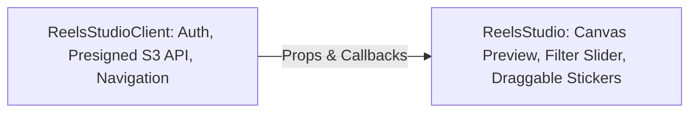
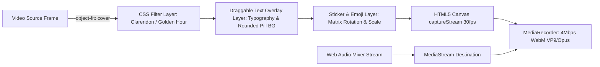
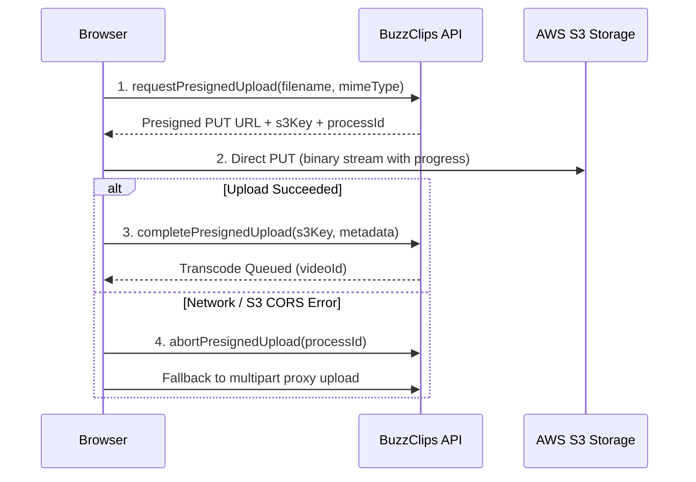

# BuzzClips Design Patterns & Best Practices

This document outlines the software design patterns, architectural paradigms, and best practices implemented throughout the BuzzClips (`bideo_ui`) codebase.

---

## 1. Architectural & Component Design Patterns

### 1.1. Container-Presenter (Smart & Dumb Components)
* **Problem**: Mixing data fetching, state orchestration, and complex DOM presentation leads to bloated, un-testable components.
* **Solution**: BuzzClips separates orchestrators from presenters.
* **Examples**:
  * `ReelsStudioClient.tsx` (Container): Manages S3 upload orchestration, error states, and router redirection.
  * `ReelsStudio.tsx` (Presenter): Encapsulates pure editor interactions (filters, text overlays, canvas preview, playback controls).
  * `ReelsContainer.tsx` (Container) and `ReelItem.tsx` (Presenter).

### 1.2. Compound Components Pattern
* **Problem**: Rigid component interfaces requiring dozens of disconnected props for nested UI elements (modals, forms, dropdowns).
* **Solution**: Utilize Radix UI compound primitives to compose flexible UI trees with implicit shared state.
* **Examples**:
  * Form system: `<Form>` $\rightarrow$ `<FormField>` $\rightarrow$ `<FormItem>` $\rightarrow$ `<FormControl>` $\rightarrow$ `<FormMessage>`.
  * Dialog system: `<Dialog>` $\rightarrow$ `<DialogContent>` $\rightarrow$ `<DialogHeader>` $\rightarrow$ `<DialogTitle>` $\rightarrow$ `<DialogDescription>`.

---

## 2. Creative Media & Canvas Design Patterns

### 2.1. Canvas Pipeline Compositor Pattern
* **Problem**: In-browser video editing must composite video frames, CSS color filters, arbitrary font styles, vector stickers, and multi-track audio at 30-60 FPS without server-side FFmpeg queue delays.
* **Solution**: A sequential frame-rendering pipeline inside `exportEngine.ts`:

### 2.2. Procedural Audio Synthesizer Pattern (Zero-Asset Offline Audio)
* **Problem**: Background music tracks stored as static external audio assets can fail due to CORS, network drops, or licensing issues.
* **Solution**: `audioEngine.ts` implements a procedural Web Audio oscillator engine that synthesizes musical chords (7th chords, bass kicks, arpeggiated lead melodies) directly on the client's DSP thread. It operates 100% offline with zero external bandwidth.

---

## 3. Distributed Cloud & Network Design Patterns

### 3.1. Direct-to-Storage with Two-Phase Handshake & Compensation
* **Problem**: Streaming large multi-gigabyte video uploads through an application proxy server creates severe CPU/memory bottlenecks and server timeouts.
* **Solution**: The Direct S3 upload pattern:
  1. **Prepare Phase**: Request signed S3 upload coordinates (`uploadUrl`, `s3Key`, `processId`).
  2. **Direct Transfer**: Stream raw binary payload directly from client browser to AWS S3.
  3. **Commit Phase**: Notify backend via `completePresignedUpload` to register catalog metadata and trigger ABR transcode jobs.
  4. **Compensating Action**: If S3 upload fails or is canceled, dispatch `abortPresignedUpload` to delete staging chunks and release database locks.

### 3.2. Graceful Degradation & Polling Fallback (SSE Strategy)
* **Problem**: Long-running asynchronous operations (such as multi-rendition HLS transcoding) need real-time progress updates, but Server-Sent Events (SSE) connections can drop on unstable mobile networks.
* **Solution**:
  * Primary: Connect to SSE stream `/vid/upload/process/{id}/progress`.
  * Fallback: If `eventSource.onerror` fires, automatically switch to REST polling (`/vid/{videoId}/status`) every 3 seconds until completed.

---

## 4. State & Authentication Design Patterns

### 4.1. Single Source of Truth for Session State
* `store/auth-context.tsx` centralizes token management, user profile resolution, and authentication lifecycle.
* All access-restricted components (such as `ReelsStudio`, `ReelsStudioBanner`, and `UploadPage`) read from `useAuth()` to conditionally gate actions, render custom profile badges, and redirect guests to `/auth/login`.

### 4.2. Safe Hydration & Next.js Dynamic Sizing
* Responsive mobile-first layouts utilize aspect-ratio styling (`w-[340px] h-[604px] sm:w-[360px] sm:h-[640px]`) and `playsInline` video elements to ensure flicker-free rendering on iOS Safari and Android Chrome.
