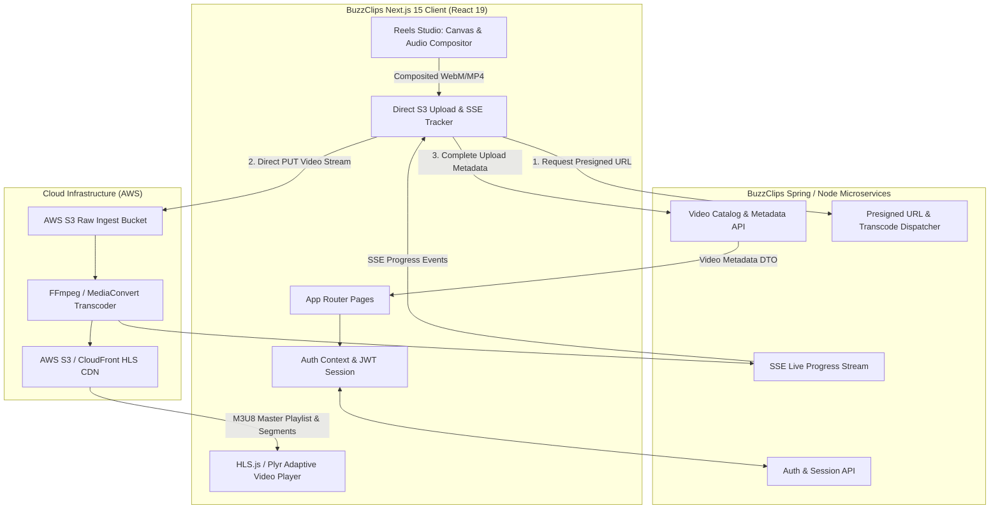

# BuzzClips Architecture Documentation

Welcome to the architectural documentation for **BuzzClips** (`bideo_ui`), India's high-performance video sharing and reels streaming platform.

---

## 1. High-Level Architecture Overview

BuzzClips connects modern web creators with viewers across desktop, tablet, and mobile devices. The architecture emphasizes zero-latency video playback, direct-to-cloud storage uploads with live transcoding progress, and client-side creative tools like the **Instagram Reel-like Editor Studio**.



---

## 2. Technology Stack

| Layer | Technology | Purpose |
| :--- | :--- | :--- |
| **Framework** | Next.js 15 (App Router with Turbopack) | Server/Client rendering, routing, SEO metadata |
| **UI Library** | React 19 | Declarative UI, hooks, concurrent rendering |
| **Styling** | Tailwind CSS v4 + `tw-animate-css` | Atomic utility styling with modern `@theme inline` OKLCH color palettes |
| **Primitives** | Radix UI (`@radix-ui/*`) | Accessible dialogs, dropdowns, switches, tabs, and avatar primitives |
| **Player Engine** | `hls.js` + `plyr` | Buffer-free adaptive bitrate (ABR) streaming across 360p, 720p, 1080p |
| **Reels Studio** | HTML5 Canvas 2D + Web Audio API + MediaRecorder | Client-side 9:16 vertical video compositor, filters, stickers & procedural synth |
| **Data Fetching** | Axios + TanStack React Query v5 | Data fetching, direct S3 binary streaming, cache invalidation |
| **Forms & Validation** | React Hook Form + Zod | Schema-driven form validation and typesafe inputs |
| **Notifications** | Sonner | Stacked toast notifications |

---

## 3. Core Subsystems

### 3.1. BuzzClips Reels Studio (Instagram Reel-like Editor)
Located in `components/reels-studio/` and routed at `/reels/create`:
* **Client-side Compositor (`exportEngine.ts`)**: Combines raw video, CSS filter transforms, draggable typography text overlays, sticker badges, and Web Audio streams onto an offscreen canvas at 1080x1920 (9:16 vertical), encoded at 4Mbps VP9/Opus via `MediaRecorder`.
* **Procedural Sound Engine (`audioEngine.ts`)**: Synthesizes melodic beats (Lo-Fi, Cyberpunk, Summer Pop, Acoustic) using Web Audio oscillators and biquad filters with zero network dependencies, plus custom audio track mixing.
* **Camera Recorder (`ReelCameraRecorder.tsx`)**: In-browser webcam/mobile camera recording with a 3-second countdown timer, front/rear camera flip, and microphone mute.
* **Gated Creator Access**: Restricts studio functionality to authenticated users via `useAuth()`.
* **Direct Upload Bridge**: Emits a standard `File` directly into the BuzzClips S3 presigned upload pipeline with automated tagging and entertainment categorization.

### 3.2. Direct-to-S3 Presigned Upload Pipeline
Located in `components/video/UploadPage.tsx` and `utility/requests.ts`:
1. **Presigned URL Exchange**: Client requests a signed S3 PUT URL (`requestPresignedUpload`) without streaming gigabytes of raw data through application backend proxies.
2. **Direct S3 Upload**: Client sends binary video data directly to AWS S3 with fine-grained upload progress calculation.
3. **Completion & Abort Handshake**: Once uploaded, client calls `completePresignedUpload`. If a network fault or user cancellation occurs, `abortPresignedUpload` cleans up orphaned S3 parts.
4. **Resilient Legacy Fallback**: Automatically falls back to multipart proxy upload if S3 CORS or network issues occur.

### 3.3. Live Transcoding Status (SSE + REST Polling)
* Connects via Server-Sent Events (`EventSource`) to `/vid/upload/process/{processId}/progress`.
* Tracks transcoding stages: `QUEUED` $\rightarrow$ `PROBING` $\rightarrow$ `TRANSCODING_HLS` $\rightarrow$ `GENERATING_THUMBNAILS` $\rightarrow$ `COMPLETED`.
* Implements automatic fallback to REST polling (`/vid/{videoId}/status`) every 3 seconds if SSE connection drops.

### 3.4. Adaptive Bitrate (ABR) Video Streaming
Located in `components/player/VideoPlayer.tsx` and `components/reels/`:
* Powered by `hls.js`.
* Automatically negotiates screen resolution, network bandwidth, and device capacity to switch between multi-rendition qualities.
* Integrates custom BuzzClips controls with keyboard navigation, theater mode, and full-screen viewports.

---

## 4. Directory & Module Structure

```
bideo_ui/
├── app/                        # Next.js App Router (pages, layouts, metadata)
│   ├── auth/                   # Authentication routes (login, register)
│   ├── channel/                # Creator channel pages (@username)
│   ├── my-videos/              # Creator video management dashboard
│   ├── reels/                  # Reels feed & dedicated /reels/create studio
│   ├── video/upload/           # Direct video upload page
│   ├── watch/[id]/             # Single video watch & playback page
│   ├── layout.tsx              # Root HTML & body shell with providers
│   └── globals.css             # Tailwind v4 theme definitions
├── components/                 # Reusable UI & business feature components
│   ├── partials/               # Navbar, Footer, MobileNav, Sidebar
│   ├── player/                 # HLS Video Player & controls
│   ├── reels/                  # Vertical Reels feed & gesture navigation
│   ├── reels-studio/           # Instagram Reel-like vertical editor studio
│   ├── ui/                     # Radix UI design system primitives
│   └── video/                  # UploadPage, ReelsStudioBanner, Comments
├── store/                      # Global context (auth-context.tsx)
├── types/                      # TypeScript schemas (video.ts, auth.ts)
├── utility/                    # API clients (requests.ts), SEO helpers (seo.ts)
└── architecture/               # System architecture & design patterns documentation
```
